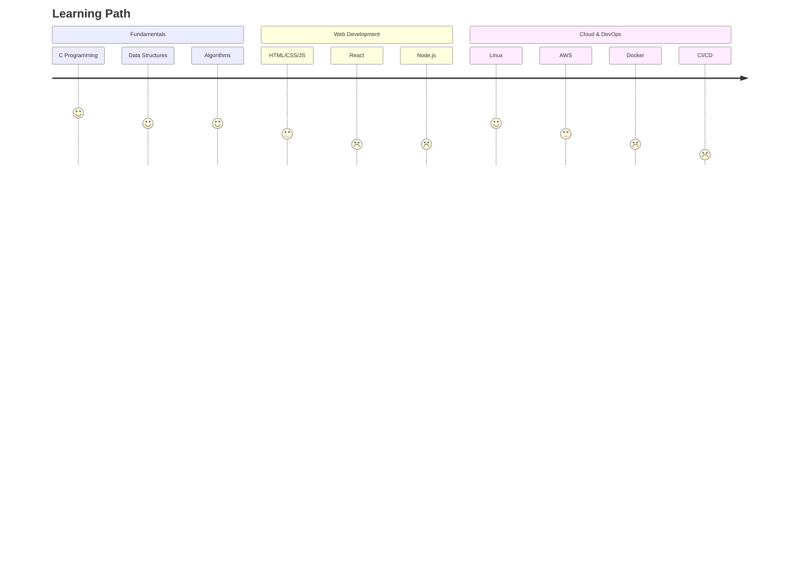

<div align="center">
  
</div>

<div align="center">
  
  
</div>

---

### 👨‍💻 About Me

```yaml
name: Justine Lloyd Bautista
location: Philippines 🇵🇭
education: Bachelor of Science in Information Technology
current_focus: AWS, Linux, LaTeX, Full-Stack Development
goal: Software Engineer
```

- 🔭 Currently completing my **BSIT degree**
- 🌱 Learning **AWS**, **Linux**, **LaTeX**, and modern **Full-Stack** development
- ⚡ Passionate about building scalable, clean software solutions
- 💡 Always exploring new technologies and best practices

---

### 🛠️ Tech Stack

<div align="center">
  


</div>

---

### 📊 GitHub Stats

<div align="center">
  
  
</div>

<div align="center">
  
</div>

---

### 📫 Connect With Me

<div align="center">
  
[](https://www.linkedin.com/in/justine-lloyd-bautista-666432228)
[](mailto:justinelloydgbautista.pupsj@gmail.com)
[](https://your-portfolio-url.com)
[](https://github.com/AgustinUno1212)

</div>

---

### 🎯 Featured Projects

| Project | Description | Tech Stack | Status |
|---------|-------------|------------|--------|
| *[Project Name]* | Brief description of what it does | `Tech1` `Tech2` `Tech3` | 🚧 WIP |
| *[Project Name]* | Brief description of what it does | `Tech1` `Tech2` `Tech3` | ✅ Done |
| *[Project Name]* | Brief description of what it does | `Tech1` `Tech2` `Tech3` | 📋 Planned |

> **Note:** Replace the placeholder projects above with your actual repositories!

---

### 📈 Current Learning Journey



---

<div align="center">
  
</div>

---

<div align="center">
  <sub>Built with ❤️ by <a href="https://github.com/AgustinUno1212">Justine Bautista</a> | 
  <a href="https://github.com/anuraghazra/github-readme-stats">GitHub Readme Stats</a> • 
  <a href="https://github.com/DenverCoder1/readme-typing-svg">Readme Typing SVG</a></sub>
</div>