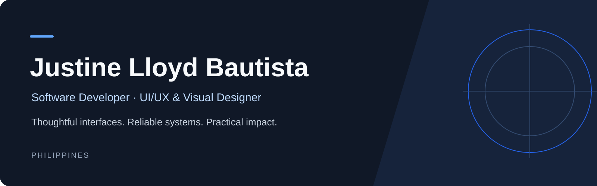

 

  
  &nbsp;
  
  &nbsp;
  
  &nbsp;
  

 

> **Design-driven full-stack engineer** with **9+ years of visual design experience** and production experience shipping data-critical internal MIS tools for a **PhilHealth-accredited Health IT Provider** serving **2,000+ healthcare units nationwide**.  
> Graduated **Magna Cum Laude (GPA 1.2 · Rank 1 IT Graduate, Rank 3 Overall Campus)** from **PUP San Juan** (Sept 2026).

 

---

### `01` · EXPERIENCE

<table>
  <tr>
    <td width="32%" valign="top">
      <b>Eurolink Network International Corp.</b> 
      Software Developer · 2026 
      <kbd>Internal MIS</kbd> <kbd>NDA</kbd>
    </td>
    <td width="68%" valign="top">
      Shipped production internal tools for the <b>ENIC MIS suite</b> at one of seven PhilHealth-accredited HITPs in the Philippines (serving <b>2,000+ healthcare units</b>).  
      • <b>Claims XML Data Engine:</b> Built a web-native validation tool processing <b>50,000+ rows per run</b>; resolved a Chromium memory overflow via binary-level optimization and browser thread management for zero-lag financial accuracy. 
      • <b>Real-Time Collaborative Notes:</b> Architected a Notion-style multi-user interface using <b>Tiptap, Yjs, and SignalR</b> with RBAC and live caret tracking.
    </td>
  </tr>
  <tr>
    <td width="32%" valign="top">
      <b>PUP San Juan · QA Office</b> 
      Full-Stack Developer · 2023–2026 
      <kbd>University Systems</kbd>
    </td>
    <td width="68%" valign="top">
      Led full-stack development, UI/UX architecture, and technical support for digital accreditation workflows, streamlining document evaluation cycles across the university.
    </td>
  </tr>
  <tr>
    <td width="32%" valign="top">
      <b>GLITCH & Student Council</b> 
      VP for Comms & Lead Designer · 2022–Present 
      <kbd>Leadership</kbd> <kbd>Brand</kbd>
    </td>
    <td width="68%" valign="top">
      Directed visual identity, creative teams, and campaign systems for 3 consecutive years at <b>GLITCH</b> and for the <b>PUPSJ Student Council</b> alongside independent client work.
    </td>
  </tr>
</table>

 

---

### `02` · SELECTED WORK

<table>
  <tr>
    <td width="50%" valign="top">
      <h4>ENIC Healthcare MIS Suite</h4>
      
<kbd>ASP.NET Core (.NET 10)</kbd> <kbd>SignalR</kbd> <kbd>Tiptap</kbd> <kbd>Yjs</kbd> <kbd>XML</kbd>

      
Proprietary internal MIS modules built for large-scale hospital reimbursement validation (50,000+ rows/run) and real-time cross-department documentation.

      
🔒 <i>Proprietary Production System (Under NDA)</i>

    </td>
    <td width="50%" valign="top">
      <h4>PUPSJ-CON · Accreditation Platform</h4>
      
<kbd>Laravel</kbd> <kbd>PostgreSQL</kbd> <kbd>Tailwind CSS</kbd> <kbd>Figma</kbd>

      
Led a 5-member team as PM, Lead UI/UX, and Full-Stack Developer. Digitized institutional accreditation with RBAC, server-side search, and automated document workflows.

      
🏆 <i>Best Capstone Awardee · PUP San Juan</i>

    </td>
  </tr>
  <tr>
    <td width="50%" valign="top">
      <h4>YAKAP · Partner Platform Identity</h4>
      
<kbd>Figma</kbd> <kbd>Design Systems</kbd> <kbd>Typography</kbd> <kbd>Brand</kbd>

      
Designed two competing comprehensive visual identity systems and typography guidelines for a PhilHealth-integrated partner platform pitched to executive leadership.

      
<a href="https://www.behance.net/lloydbautista"><b>View design portfolio on Behance →</b></a>

    </td>
    <td width="50%" valign="top">
      <h4>Project V · Vaccine Management</h4>
      
<kbd>Java</kbd> <kbd>PHP</kbd> <kbd>MySQL</kbd>

      
Desktop and backend vaccination tracking platform built to resolve scheduling and record bottlenecks; awarded <b>Top 1 Best Project</b> at the Asia Pacific College bootcamp cohort.

      
<a href="https://github.com/AgustinUno/vaccine-management-system-2021"><b>View repository →</b></a>

    </td>
  </tr>
</table>

  <a href="https://github.com/AgustinUno?tab=repositories"><b>Explore all public repositories →</b></a>

---

### `03` · STACK & TOOLING

<table>
  <tr>
    <td align="center" width="33%" valign="top">
      <b>APPLICATION DEVELOPMENT</b>  
      <picture>
        <source media="(prefers-color-scheme: dark)" srcset="https://skillicons.dev/icons?i=ts,js,php,java,react,tailwind,laravel,dotnet&theme=dark&perline=4" />
        
      </picture>
        
      <kbd>React</kbd> <kbd>Tailwind</kbd> <kbd>Laravel</kbd> <kbd>.NET 10</kbd>
    </td>
    <td align="center" width="33%" valign="top">
      <b>DATA & INFRASTRUCTURE</b>  
      <picture>
        <source media="(prefers-color-scheme: dark)" srcset="https://skillicons.dev/icons?i=postgres,mysql,git,docker,linux,debian&theme=dark&perline=3" />
        
      </picture>
        
      <kbd>PostgreSQL</kbd> <kbd>SQL Server</kbd> <kbd>Docker</kbd> <kbd>Linux</kbd>
    </td>
    <td align="center" width="33%" valign="top">
      <b>DESIGN & PROTOTYPING</b>  
      <picture>
        <source media="(prefers-color-scheme: dark)" srcset="https://skillicons.dev/icons?i=figma,ps,ai,ae,blender&theme=dark&perline=3" />
        
      </picture>
        
      <kbd>Figma</kbd> <kbd>Affinity</kbd> <kbd>UI/UX</kbd> <kbd>9+ Yrs Exp</kbd>
    </td>
  </tr>
</table>

  
<b><code>+</code> View Honors, Cybersecurity CTF & Certifications</b>

   
  <ul>
    <li><b>Academic Honors (PUP San Juan, 2026):</b> Magna Cum Laude (GPA: 1.2) · Rank 1 Overall IT Graduate · Rank 3 Overall Campus · Junior Programmer of the Year · Best Capstone · Public Service Award.</li>
    <li><b>Trend Micro Capture The Flag (Oct 2025):</b> Ranked <b>80th Nationwide</b> in Linux exploitation and defensive security against university and professional teams.</li>
    <li><b>AWS Cloud Club Solar Power Hackathon (July 2025):</b> Cloud infrastructure planning and technical builder (Team TLP).</li>
    <li><b>Quality Assurance & Systems:</b> 50,000+ record dataset validation, boundary/edge-case testing, REST/API validation, Linux (Debian 13, RHEL, Arch, Sway WM), Cisco & Fortinet firewalls.</li>
    <li><b>Certifications:</b> Lean Six Sigma Yellow Belt · Fortinet Certified Associate in Cybersecurity · FortiGate 7.6 Operator · Cisco Cyber Threat Management · Salesforce Supported Virtual Internship · DTI Graphic Design for SMB & Marketing.</li>
  </ul>

 

---

### `04` · ACTIVITY

  <picture>
    <source media="(prefers-color-scheme: dark)" srcset="https://github-readme-stats.vercel.app/api?username=AgustinUno&show_icons=true&hide_border=true&theme=github_dark&hide_rank=true&title_color=2563EB&icon_color=2563EB" />
    
  </picture>
  <picture>
    <source media="(prefers-color-scheme: dark)" srcset="https://github-readme-stats.vercel.app/api/top-langs/?username=AgustinUno&layout=compact&hide_border=true&theme=github_dark&langs_count=6&title_color=2563EB" />
    
  </picture>
   
  <i>Production healthcare MIS work is hosted in private enterprise repositories under NDA. Public metrics reflect open-source and academic repositories.</i>

 

---

  Have a role, system architecture challenge, or design project in mind? <a href="mailto:justinelloydgbautista.pupsj@gmail.com"><b>Let's talk →</b></a>

