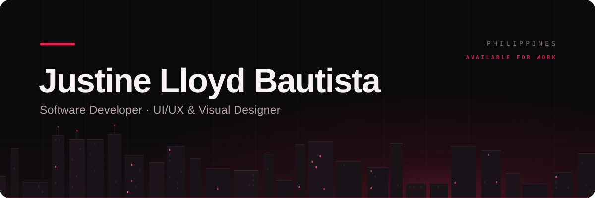

 

  

*Design-driven full-stack engineer shipping data-critical internal tools for a PhilHealth-accredited health IT provider. 9+ years in visual design · 50,000+ rows per run · 2,000+ healthcare units served.*

---

## 01 · About

Profile: design-driven full-stack engineer serving a PhilHealth-accredited HITP. Mission: bridge clinical accuracy with interface clarity — systems processing 50,000+ validation rows with zero-lag collaboration via Tiptap / Yjs / SignalR. Status: **available for hire / collaboration / architecture consulting**.

---

## 02 · Built With

**Application** — TypeScript · JavaScript · React · Laravel · .NET · Tailwind CSS

**Data & Infrastructure** — PostgreSQL · MySQL · Git · Docker · Linux · Debian

**Design & Prototyping** — Figma · Design Systems · Typography

---

## 03 · Experience

**Eurolink Network International Corp.** — Software Developer — 2026  
`Internal MIS` · `NDA`
- Shipped production internal tools for the ENIC MIS suite at one of seven PhilHealth-accredited HITPs in the Philippines, serving 2,000+ healthcare units nationwide.
- **Claims XML Data Engine:** web-native validation processing 50,000+ rows / run; resolved Chromium memory overflow via binary-level optimization for zero-lag financial accuracy.
- **Real-Time Collaborative Notes:** Notion-style multi-user interface with Tiptap, Yjs, SignalR, RBAC, live caret tracking.

**PUP San Juan — QA Office** — Full-Stack Developer — 2023–2026  
`University Systems`
- Full-stack development, UI/UX architecture, and technical support for digital accreditation workflows, streamlining document evaluation cycles across the university.

**GLITCH & Student Council** — VP for Comms & Lead Designer — 2022–Present  
`Leadership` · `Brand`
- Directed visual identity, creative teams, and campaign systems for 3 consecutive years.

---

## 04 · Honors & Certifications

**PUP San Juan, Sept 2026.** Magna Cum Laude (GPA 1.2 — PH scale) — Rank 1 Overall IT Graduate — Rank 3 Overall Campus — Junior Programmer of the Year — Best Capstone — Public Service Award.

**Trend Micro Capture The Flag, Oct 2025.** 80th nationwide, Linux exploitation / defensive security.

**AWS Cloud Club Solar Power Hackathon, July 2025.** Technical builder (Team TLP).

*Certifications:* Lean Six Sigma Yellow Belt · Fortinet Associate Cybersecurity · FortiGate 7.6 Operator · Cisco Cyber Threat Management · Salesforce Virtual Internship · DTI Graphic Design for SMB & Marketing.

*Systems background:* 50,000+ record dataset validation · REST/API validation · Linux (Debian 13, RHEL, Arch, Sway WM) · Cisco / Fortinet firewalls.

---

## 05 · Activity

  <picture>
    <source media="(prefers-color-scheme: dark)" srcset="https://github-readme-stats.vercel.app/api?username=AgustinUno&show_icons=true&hide_border=true&theme=github_dark&hide_rank=true&title_color=e0244e&icon_color=e0244e" />
    
  </picture>
  <picture>
    <source media="(prefers-color-scheme: dark)" srcset="https://github-readme-stats.vercel.app/api/top-langs/?username=AgustinUno&layout=compact&hide_border=true&theme=github_dark&langs_count=6&title_color=e0244e" />
    
  </picture>
   
  <i>Production MIS work is hosted in private repositories under NDA. Public metrics reflect open-source and academic repositories.</i>

 

  <!-- Live skyline from the hosted GitCity instance. `theme=gold` is the closest amber to
       the Gitskin palette; switch to `theme=gitskin` once a self-hosted build is deployed. -->
  
   
  <i>One year of contributions, built into a city — <a href="https://gitcity.natrajx.in/AgustinUno">explore it in 3D</a>.</i>

---

## 06 · Selected Work

**ENIC Healthcare MIS Suite** — Proprietary internal MIS modules (`ASP.NET Core · SignalR · Tiptap · Yjs · XML`). Featured production system, under NDA. [How the claims engine was built →](docs/case-study-claims-xml-engine.md)

**PUPSJ-CON — Accreditation Platform** — `Laravel · PostgreSQL · Tailwind CSS · Figma`. Best Capstone Awardee — PUP San Juan.

**YAKAP — Partner Platform Identity** — `Figma · Design Systems · Typography`. Design pitch for a PhilHealth-integrated partner platform.

**Project V — Vaccine Management** — `Java · PHP · MySQL`. Desktop + backend vaccination tracking awarded Top 1 Best Project at the Asia Pacific College bootcamp. [Repository →](https://github.com/AgustinUno/vaccine-management-system-2021)

---

## 07 · Stack & Tooling

**Application Development:** TypeScript · JavaScript · React · PHP · Java · Tailwind CSS · Laravel · ASP.NET (.NET 10)

**Data & Infrastructure:** PostgreSQL · MySQL · Git · Docker · Linux · Debian

**Design & Prototyping:** Figma · Design Systems · Typography · Brand

---

## 08 · Contact

**Status:** Available for hire · **LinkedIn:** [in/justine-lloyd-bautista-666432228](https://www.linkedin.com/in/justine-lloyd-bautista-666432228) · **Behance:** [lloydbautista](https://www.behance.net/lloydbautista) · **Email:** [justinelloydgbautista.pupsj@gmail.com](mailto:justinelloydgbautista.pupsj@gmail.com) · [Explore repositories](https://github.com/AgustinUno)

---

*Clean design · Red accent · Gitskin theme · Profile README — updated 2026-11-03*

<!-- pushed: 2026-11-01 -->
